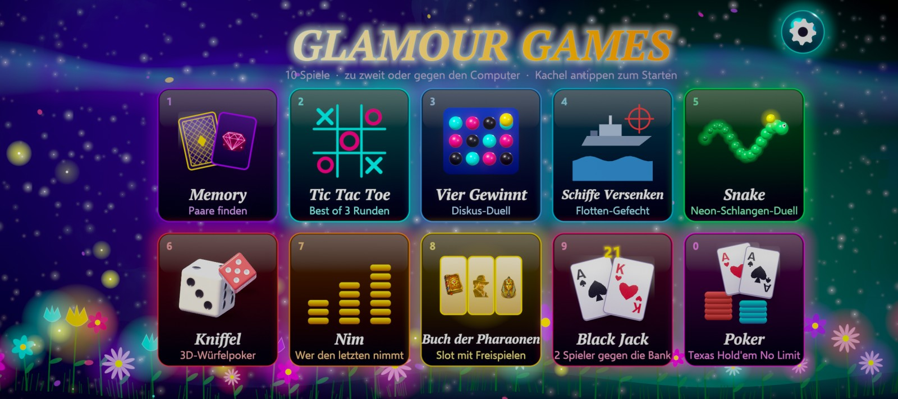

# Glamour Games Unity Android

**10 glitzernde Spiele für Android – zu zweit am selben Gerät, gegen den Computer (Leicht / Mittel / Schwer) oder per Bluetooth mit 2–4 Spielern.**
Android-Schwesterprojekt der [Glamour Games Unity Edition für Windows](https://github.com/domezos2024/glamour_games_unity) (`domezos2024/glamour_games_unity`; Unity 6.3 LTS, URP, HDR-Bloom, 3D-Physik). Beide Repos teilen den Spielcode und das Bluetooth-Protokoll; Android-spezifisch sind nur `AndroidBt.cs`, `GlamourBt.java` und der Build, Windows-spezifisch nur `WinBt.cs`.
Privates Repository.



## Funktionsumfang

* Alle 10 Spiele mit vollständiger Spiellogik und KI-Gegnern: Memory, Tic Tac Toe, Vier Gewinnt, Schiffe Versenken, Snake, Kniffel, Nim, Slot, Blackjack, Poker.
* Gleiche Grafik wie die Windows-Version: SDF-Renderer, HDR-Bloom, 3D-Würfel mit Starrkörperphysik, 3D-Münze, Chips, Schiffe, Siegerpokal in PBR-Gold, Feuerwerk, Münzregen, Luftschlangen.
* Touch-Bedienung (Kacheln, Buttons, Spielfeld), Zurück-Taste (zweimal im Menü beendet die App), Pause bei Verlassen der App.
* Bildschirmtastatur im Namens-Dialog (Highscore), Haptik (abschaltbar in den Optionen), Ton mit Musik/Effekt-Schalter.
* Sicherer Bereich: Display-Aussparungen (Cutout) und Navigationsleiste werden ausgespart, der Hintergrund füllt trotzdem den ganzen Bildschirm.
* Adaptive Render-Auflösung (`AdaptiveQuality`) hält die Bildrate stabil; 60-FPS-Limit, MSAA 4 für die 3D-Rigs.
* **Bluetooth-Mehrspieler:** Memory, Kniffel, Snake, Blackjack und Poker mit **2–4 Spielern** (ein Host, bis zu drei Gäste, Stern-Topologie, Host entscheidet alles); Tic Tac Toe, Vier Gewinnt, Schiffe Versenken, Nim und Slot zu zweit. Handy mit Handy oder Handy mit PC ([Windows-Version](https://github.com/domezos2024/glamour_games_unity)). Geräte koppeln, im Menü (Symbol oben links) eröffnen bzw. beitreten; der Eröffner wählt das Spiel. Bei Verbindungsverlust pausiert die Partie bis zu 45 s und läuft nach Wiederverbindung weiter. Hinweis: 3–4 Teilnehmer sind bisher nur per Simulation geprüft, nicht mit echten Geräten (Stand siehe `docs/Mehrspieler-Spezifikation.md`). Die Windows-Version spielt aktuell noch die Zwei-Spieler-Variante.
* **Realistische Physik:** echte Fallbeschleunigung je Objektgröße, Stöße mit Restitution und Reibung, Kniffel-Würfel stoßen aneinander und lassen sich per Wischgeste werfen, Karten rutschen über den Filz, Chips fallen auf den Stapel, Walzen rasten federnd ein, Schiffe schaukeln und sinken mit Schlagseite, Pokal kippelt aus.

## Technik

| | |
| --- | --- |
| Engine | Unity 6000.3.25f1, URP 17.3 |
| Zielplattform | Android 8.0+ (API 26), ARM64, IL2CPP, Vulkan mit GLES3-Fallback |
| Paket-ID | `de.domezosware.glamourgames.unityandroid` |
| Ausrichtung | Querformat (automatisch gedreht) |
| Designraum | 1600 × 900, Anpassung per Kamera (Letterbox-frei, Ränder zeigen Hintergrund) |

Plattformcode: `Assets/Glamour/Scripts/Core/Platform.cs` (Touch-Erkennung), `Haptics.cs` (JNI-Vibration), `App.cs` (Ansicht/Safe-Area, Touch, Lebenszyklus), `Scene.cs` (Bildschirmtastatur im Modal), `URP/AdaptiveQuality.cs`.

## Bauen

```powershell
# Voraussetzung: Unity 6000.3.25f1 mit Android-Modul (SDK, NDK, OpenJDK)
Unity.exe -batchmode -quit -buildTarget Android -projectPath <Repo> `
  -executeMethod GlamourGames.EditorTools.ProjectBootstrap.CiBuild `
  -buildPath <Ziel>\GlamourGamesUnityAndroid.apk [-aab] [-development] [-versionCode N] -logFile build.log
```

Alternativ im Editor: Menü **Glamour Games / Android-APK erstellen**. Der erste Build dauert rund 9 Minuten.

### Signierung

Release-Builds werden signiert, wenn diese Umgebungsvariablen gesetzt sind (der Schlüssel liegt **nicht** im Repository):

`GLAMOUR_KEYSTORE`, `GLAMOUR_KEYSTORE_PASS`, `GLAMOUR_KEY_ALIAS`, `GLAMOUR_KEY_PASS`

Ohne diese Variablen wird mit dem Debug-Schlüssel signiert. Wer Updates ausliefert, muss immer denselben Schlüssel benutzen.

## Installieren und Testen

```powershell
Tools\Android\install_run.ps1          # installiert die APK per adb und startet die App
Tools\Android\vd.ps1                   # Testwerkzeug: virtuelles Display (scrcpy) für gesperrtes Gerät
```

`vd.ps1` erlaubt Screenshots, Touch-Eingaben, Zurück-Taste und Leistungsabfrage (`Vd-Perf`) auch bei gesperrtem Telefon. Ablauf siehe Kopfkommentar der Datei.

## Getestet

* 2–4 Spieler: 251 automatische Konsolenprüfungen (`Tools/Tests`: Protokoll, Sitzung, Transportvertrag, Poker-Regeln) ohne Fehler; Mehrprozess-Läufe über TCP für Memory (3), Kniffel (3), Snake (4), Blackjack (3), Poker (3 und 4); App-Start auf dem Pixel 10. **Nicht geprüft:** 3–4 echte Bluetooth-Geräte, Geräte-Matrix, Profiling mit vier Spielern.
* Die folgenden Bluetooth-Läufe stammen aus der früheren Zwei-Spieler-Version:

* Bluetooth Pixel 10 ↔ Windows-PC (Realtek-Adapter) in beiden Richtungen: Verbindung, Spielwahl durch den Eröffner, gespiegelter Münzwurf, komplette Zugfolge Vier Gewinnt. Alle 10 Spiele zusätzlich im Zwei-Prozess-Test (Vorschau über TCP) synchron.
* Pixel 10 (Android 16): Start, Menü, alle 10 Spiele mit Gegnerwahl, Münzwurf, KI-Partie Vier Gewinnt bis zum Sieg, Zurück-Taste, 3D-Rigs (Würfel, Münze, Pokal).
* Keine Unity-Fehler oder Ausnahmen im Log während der Tour. Auf dem virtuellen Display (zusätzliche Video-Kodierung durch scrcpy) laufen die Spiele bei 44–52 FPS mit adaptiver Auflösung 0,6; auf dem echten Display ist die Last geringer.

## Dokumentation

* [`docs/ENGINE.md`](docs/ENGINE.md) – Engine, Spiel-API, Bluetooth-Übersicht
* [`docs/Mehrspieler-Spezifikation.md`](docs/Mehrspieler-Spezifikation.md) – Regeln, Teststand und Review-Checkliste für 2–4 Spieler
* [`ChatGPT-Verbesserungen.md`](ChatGPT-Verbesserungen.md) – Maßnahmenliste mit Abhak-Stand
* [`dies-für-windows-version.md`](dies-f%C3%BCr-windows-version.md) – Schritte, um die Änderungen im Windows-Repo [`glamour_games_unity`](https://github.com/domezos2024/glamour_games_unity) nachzuziehen
